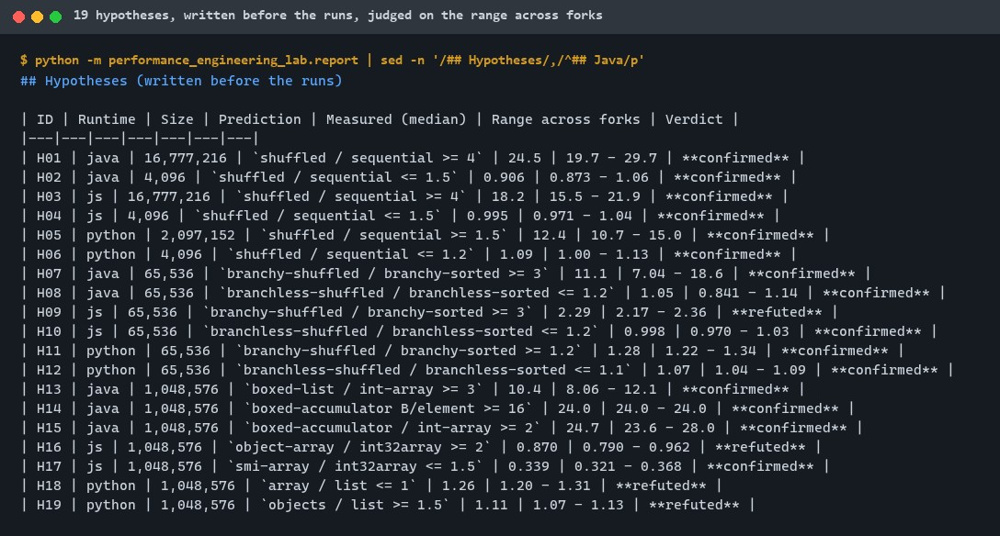
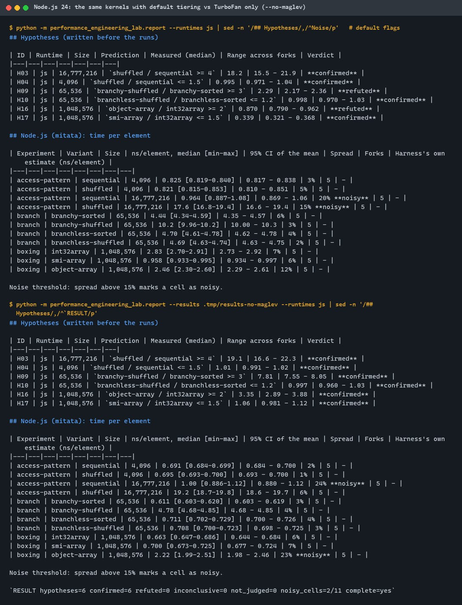
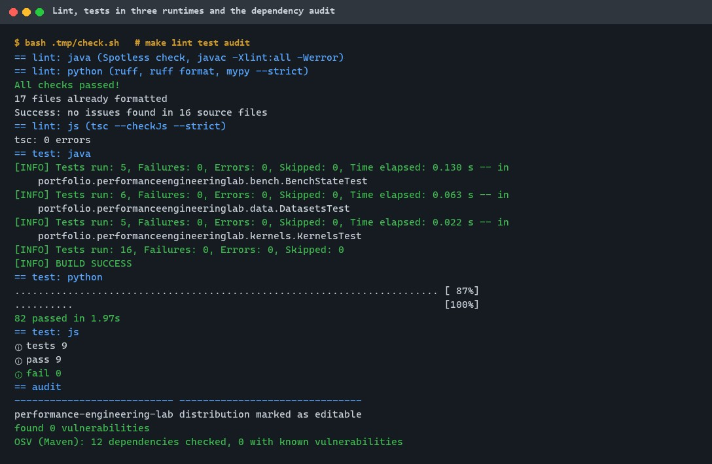
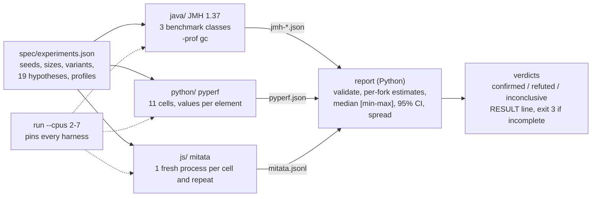
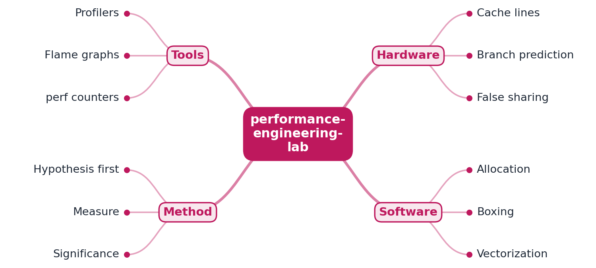

# performance-engineering-lab

[](https://github.com/EquinoxWN/performance-engineering-lab/actions/workflows/ci.yml)


> Why two functions with the same Big-O differ 10x in practice: cache lines, branch prediction and allocation, measured not guessed.

Part of my **CS Foundations** list · Java · Python · JS

## Proof it works

19 hypotheses were written into [`spec/experiments.json`](spec/experiments.json) before anything
was measured, then judged on the worst-case range across forks: JMH (3 forks) for Java, pyperf
(5 processes) for CPython, mitata (5 fresh processes) for Node.js, all pinned to performance cores.
15 held and 4 did not:



Two Node.js hypotheses failed because, with default flags, the measured functions ran far below
TurboFan speed. The same kernels with `--no-maglev` confirmed all six JavaScript hypotheses:



Lint, 107 tests in three languages and a clean dependency audit:



## Architecture

**What M1 runs today:**



**Full roadmap (M1 to M3):**



## How it works

_Steps 1 and 2 are built and tested (M1); the rest is on the [roadmap](#roadmap)._

1. Each experiment starts with a hypothesis, e.g. 'struct-of-arrays beats array-of-structs by 3x here'.
2. Micro-benchmarks use each language's proper harness (JMH, pyperf, mitata) to avoid measurement traps.
3. Linux perf reads hardware counters (cache and branch misses) to explain each result, not just report it.
4. Flame graphs from async-profiler, py-spy and clinic.js locate hot paths in a realistic mini-service.
5. Fixes are applied one at a time, each with a statistically significant before/after.
6. The write-up separates the optimizations that mattered from the ones that were noise.

Three experiments, each the same O(n) work in every variant (checked before timing):

| Experiment | Effect | Variants |
|---|---|---|
| `access-pattern` | cache lines, prefetching | sum `data[idx[i]]` with `idx` the identity or a random permutation; 16 KB and 64 MB of data |
| `branch` | branch prediction | sum the bytes >= 128 with an `if` or a bit mask, over the same 65,536 bytes sorted or shuffled |
| `boxing` | allocation, pointer chasing | Java `int[]` / `ArrayList<Integer>` / `Long` accumulator; JS `Int32Array` / small-int array / array of `{v}`; CPython `list` / `array('q')` / `__slots__` objects |

## Who it helps

- **Who:** backend engineers who need to know whether a data-layout, branch or boxing change is worth making in Java, Node.js or Python, and engineers preparing for "it got 10x slower and the algorithm didn't change" interview rounds.
- **The problem:** rules of thumb about caches, branches and boxing are often wrong for a given runtime (here: `array('q')` is slower than `list` in CPython, and a Node.js kernel can run 4x to 7x below TurboFan speed under default flags), and hand-written timing loops measure the traps instead of the effect.
- **How to use it:** add a hypothesis and a variant to `spec/experiments.json`, run `make bench CPUS=...`, and read `.tmp/results/report.md`: per-fork medians with ranges, 95% intervals, noise labels and a verdict per hypothesis. The `run` and `report` modules also work as a template for any JMH/pyperf/mitata comparison that must state its prediction first.

## Tech stack

| Area | In M1 | Planned |
|---|---|---|
| Java | Temurin 21, JMH 1.37 (avgt, 3 forks, `-prof gc`), Maven with Spotless, Enforcer, `-Xlint:all -Werror`, JUnit 6 | async-profiler flame graphs (M2) |
| Python | CPython 3.14 benchmarks with pyperf 2.10; the runner, validation, statistics and report; psutil CPU pinning; ruff, mypy `--strict`, pytest | py-spy flame graphs (M2); significance tests per fix (M3) |
| JavaScript | Node.js 24 (V8 13.6), mitata 1.0.34 in fresh processes; `tsc --checkJs --strict` | clinic.js (M2); V8 tier tracing (M2) |
| Hardware | pinned to performance cores of an i7-13700H; timings only | Linux `perf` cache-miss and branch-miss counters (M2) |
| Proof | hypotheses judged on fork ranges, `RESULT` line, CI smoke run with `::notice` | before/after flame graphs and significance tables (M3) |

One implementation per language, each in its own folder: [`java/`](java), [`python/`](python) (also
the runner and report, see its [README](python/README.md)) and [`js/`](js).

## Run it

**Prerequisites:** JDK 21+ with Maven 3.9+, Python 3.11+ and Node.js 24+. Everything installs inside the repo.

```bash
python -m venv .venv && source .venv/bin/activate   # Windows: .venv\Scripts\activate
make setup                # Python package and dev tools, npm packages
make lint                 # Spotless + javac -Xlint:all -Werror, ruff + mypy --strict, tsc --checkJs --strict
make test                 # 107 tests: Java 16, Python 82, JavaScript 9
make bench CPUS=2-7       # every experiment, full profile (about 9 minutes); CPUS optional
make bench-smoke          # 1 fork per cell: proves the pipeline, judges nothing (CI)
make audit                # pip-audit, npm audit, OSV.dev for Maven
```

`CPUS` pins every harness process (child processes inherit it); on a hybrid Intel CPU pick
performance-core threads. Single runtimes:
`python -m performance_engineering_lab.run --runtimes js --profile js-no-maglev`,
`java -jar java/target/benchmarks.jar BranchBench`, `node js/src/bench.js --experiment branch --variant branchy-sorted --size 65536`.
Every JVM is heap-capped (256 MB host, 512 MB forks) and every temp, crash and result file goes to
the git-ignored `.tmp/`.

## Tests and results

Full numbers, commands and analysis: [docs/results/m1.md](docs/results/m1.md).

| Check | Result |
|---|---|
| Tests (`make test`) | **107 passed** (Java 16, Python 82, JavaScript 9), 0 failed; full check run twice |
| Lint (`make lint`) | clean: Spotless, javac `-Xlint:all -Werror`, ruff, ruff format, mypy `--strict`, tsc `--checkJs --strict` |
| Benchmarks (`make bench CPUS=2-7`) | `RESULT hypotheses=19 confirmed=15 refuted=4 inconclusive=0 not_judged=0 noisy_cells=8/33 complete=yes` |
| Follow-up, Node.js `--no-maglev` | `RESULT hypotheses=6 confirmed=6 refuted=0 ...` |
| Mutation check | 6 deliberate bugs: 5 caught at once, 1 caught after a boundary test was added |
| Audit (`make audit`) | pip-audit and npm audit: no known vulnerabilities; OSV.dev: 12 Maven dependencies, 0 vulnerable |

**Headline results** (ns per element, median [min-max] across forks; shared laptop, pinned to P-cores):

| Result | Value |
|---|---|
| Random vs sequential gather, 64 MB | Java 16.2 vs 0.66 (24.5x); Node.js 17.6 vs 0.96 (18.2x); CPython (2M elements) 417 vs 33.7 (12.4x) |
| Same, 16 KB | 0.91x to 1.09x in all three runtimes |
| `if` on shuffled vs sorted bytes | Java 5.23 vs 0.47 (11.1x); Node.js `--no-maglev` 4.78 vs 0.61 (7.8x); CPython 31.9 vs 24.8 (1.28x) |
| Bit mask instead of `if` | flat in every runtime, but slower than the sorted `if`; in CPython slower even on shuffled bytes |
| Java `ArrayList<Integer>`, `Long` accumulator vs `int[]` | 10.4x and 24.7x slower; the `Long` accumulator allocates 24.0 B/element |
| CPython `array('q')` vs `list` | 1.26x **slower** (hypothesis refuted: every read boxes a new int) |
| Node.js default tiering vs `--no-maglev` | `Int32Array` sum 2.83 vs 0.66; branchy sorted 4.44 vs 0.61 |

| Test file | Tests | What it proves |
|---|---|---|
| `DatasetsTest`, `test_datasets_kernels.py`, `datasets-kernels.test.js` | 6 + 18 + 5 | xorshift32, values, permutation and byte checksums match the spec in all three runtimes; permutation property; every variant computes the same result (200 random inputs each); bad inputs rejected |
| `KernelsTest` | 5 | Java kernels agree across variants for 200 seeds; edge values; no overflow |
| `BenchStateTest` | 5 | JMH `@Param` defaults equal the spec; every variant's setup returns the expected sum; unknown variants rejected |
| `bench.test.js` | 4 | every JS cell computes its expected result; one valid mitata line per process; bad arguments exit 2 |
| `test_spec.py` | 23 | every cell has a hypothesis; 19 kinds of inconsistent spec refused; oversized files refused |
| `test_results.py` | 20 | real JMH, pyperf and mitata outputs parsed into per-fork samples; 13 malformed inputs refused; paths scrubbed |
| `test_stats.py` | 6 | intervals and the confirmed / refuted / inconclusive rule, including the boundary |
| `test_report.py` | 6 | complete results judged; missing or unexpected cells exit 3; noisy cells marked |
| `test_run.py` | 9 | harness commands are spec-driven, heap-capped and contained in `.tmp/`; one real pyperf run |

## Roadmap

**M1** (≈8 h)
- [x] Write `docs/rfc/0001-design.md`: problem, goals, non-goals, chosen design
- [x] Each experiment starts with a hypothesis, e.g. 'struct-of-arrays beats array-of-structs by 3x here'.
- [x] Micro-benchmarks use each language's proper harness (JMH, pyperf, mitata) to avoid measurement traps.

**M2** (≈8 h)
- [ ] Linux perf reads hardware counters (cache and branch misses) to explain each result, not just report it.
- [ ] Flame graphs from async-profiler, py-spy and clinic.js locate hot paths in a realistic mini-service.

**M3** (≈9 h)
- [ ] Fixes are applied one at a time, each with a statistically significant before/after.
- [ ] The write-up separates the optimizations that mattered from the ones that were noise.
- [ ] Publish the proof below with real numbers

## Proof

What this repo must show before it counts as done:

- Before/after flame graphs and benchmark tables with significance levels.

| Result | Value |
|---|---|
| Benchmark tables with spread, per hypothesis | Done in M1 (see [Tests and results](#tests-and-results)); significance levels per fix are M3 |
| Before/after flame graphs | Not measured yet (M2) |

## Why it matters

- **Interview angle:** 'This endpoint became 2x slower after a release: find out why' debugging rounds.
- **Upstream I'm contributing to:** async-profiler or py-spy: reproducible issues and documentation.

## Design docs

- [RFC 0001: design](docs/rfc/0001-design.md)
- [ADR 0001: record architecture decisions](docs/adr/0001-record-architecture-decisions.md)
- [ADR 0002: each runtime's own benchmark harness, one validated report](docs/adr/0002-each-runtimes-own-harness-one-report.md)
- [ADR 0003: pin to performance cores and judge hypotheses on the range across forks](docs/adr/0003-pin-performance-cores-and-judge-on-fork-ranges.md)
- [M1 results](docs/results/m1.md)

## Scope

This is a learning and portfolio system, not a hosted production service. Everything runs locally.

## Security and contributing

- Runtime dependencies are limited to the harnesses (JMH, pyperf with psutil, mitata); every GitHub Action is pinned to a commit SHA, and workflows run read-only without persisted credentials.
- Dependabot update pull requests are paused (`open-pull-requests-limit: 0`) so the repository keeps a single `main` branch; dependencies are updated by hand and checked by the CI audit.
- CI runs `pip-audit`, `npm audit` and an OSV.dev check of the Maven dependencies on every push; the runner uses fixed argument lists and the readers refuse oversized or malformed files.
- Report vulnerabilities privately: see [SECURITY.md](SECURITY.md). To contribute, see [CONTRIBUTING.md](CONTRIBUTING.md).

## License

MIT, see [LICENSE](LICENSE).
